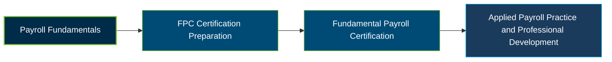

# PayrollOrg Fundamental Payroll Certification (FPC) Exam Guide

A dedicated study guide and payroll knowledge reference for candidates preparing for the **PayrollOrg Fundamental Payroll Certification (FPC) Exam**, including the FPC-Remote online-proctored delivery option.

---

## Exam Overview

The Fundamental Payroll Certification (FPC) validates foundational knowledge of payroll operations, compliance, paycheck calculations, payroll systems, administration, audits, and accounting.

- **Exam Format**: Computer-based, proctored examination; remote OnVUE delivery is available to eligible North America residents.
- **Target Audience**: Entry-level payroll professionals, payroll service provider representatives, payroll systems analysts, and sales professionals or consultants serving the payroll industry.
- **Prerequisites**: No formal exam eligibility requirements.

---

## Core Exam Domains & Knowledge Areas

### 1. Core Payroll Concepts

- Worker classification, employment taxes, and Fair Labor Standards Act requirements.
- Employee benefits, employment forms, and professional responsibility.
- Payroll methods, pay schedules, and timing of payment.

### 2. Compliance / Research and Resources

- Escheatment, legislative requirements, and regulatory compliance.
- Payroll reporting, record retention, and applicable penalties.
- Research resources and global payroll considerations.

### 3. Calculation of the Paycheck

- Compensation, employee benefits, and fringe benefits.
- Involuntary deductions, taxes, and voluntary deductions.
- Employer taxes, contributions, and total payroll calculations.

### 4. Payroll Process and Supporting Systems and Administration

- Payroll master file components and employee data maintenance.
- Payroll system concepts, functions, and processing activities.
- Business continuity planning for payroll operations.

### 5. Payroll Administration and Management

- Payroll policies, procedures, and departmental agreements.
- Customer service and professional communication.
- Payroll administration and management responsibilities.

### 6. Audits

- Internal controls and payroll system controls.
- Accounting system controls and audit procedures.
- Audit policies and documentation.

### 7. Accounting

- Financial reporting and fundamental accounting principles.
- Payroll journal entries and accounting records.
- Payroll account reconciliation.

---

## Certification Path

---

## Recommended Practice & Study Resources

Prepare for the FPC examination by combining official PayrollOrg materials, structured practice, and practical study of payroll regulations.

- **CertsGate**: Explore [FPC Remote exam preparation resources](https://certsgate.com/exams/apa/fpc-remote) for supplementary study materials and practice to help review payroll concepts and identify knowledge gaps.
- **Practical Payroll Research**: Study the [IRS Employment Taxes](https://www.irs.gov/businesses/small-businesses-self-employed/employment-taxes) guidance and [U.S. Department of Labor FLSA resources](https://www.dol.gov/agencies/whd/flsa) to reinforce payroll tax and wage-and-hour concepts.
